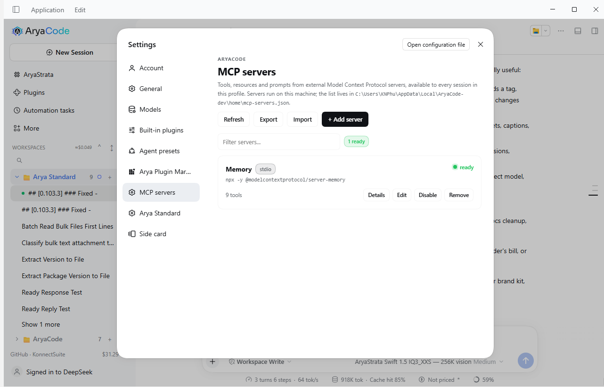
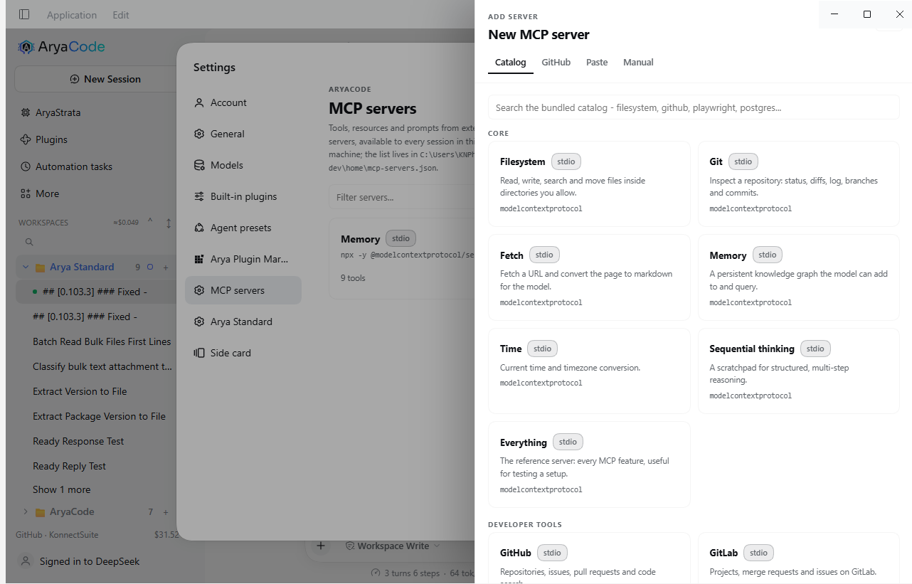
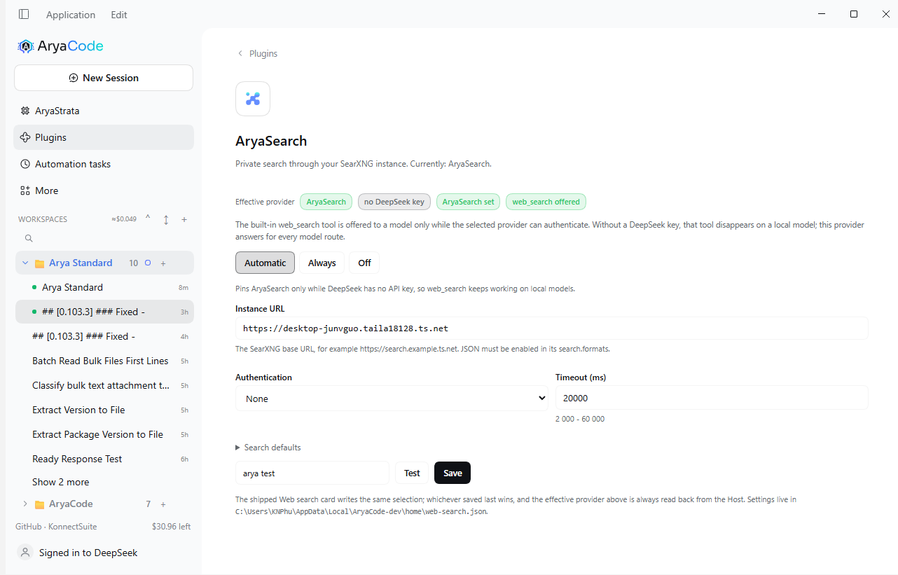

# AryaCode Polish

One install for the small things that make AryaCode feel finished.

AryaCode Polish is a plugin **bundle**: it adds surfaces to the app it is
installed into and patches nothing. It is one package, one Plugins row, and one
switch per feature, so a refinement that turns out to be wrong for a machine can
be turned off without uninstalling anything.

Status: every shipped feature is listed under [Switches](#switches), and each one has
its own off switch. The version is the package's, and the card header already shows it.

## What it is

- **One row.** The bundle inserts a single row, id `polish`, into the profile's
  composition (`cordis.patch.yml`). That row is the install surface: it mounts
  the host half of every enabled feature and names the bare package specifier so
  the Shell can find the browser face.
- **One switch per feature.** Every feature is gated by its own boolean in the
  row's Configure page, on by default. Turning it off disposes that feature only.
- **Additive.** No fork of the shell, no edits to `app.asar`, no patched
  installed app, no DOM hacks against private class names.

## Switches

Row: **AryaCode Polish** (`polish`).

Each entry in `entries/registry.js` becomes one volatile boolean in this
Configure page automatically.

| Switch | Default | What it does |
| --- | --- | --- |
| Better workspace | On | Replaces the sidebar workspace list with our own tree and a right-click menu on each workspace. |
| **Session trash** (`sessionTrash`) | On | Moves an **archived** session's transcript folder into a trash you can restore from, and empties it when you want the space back. The workspace folder and every file in it are never touched. See [Session trash](docs/session-trash.md). |
| **Estimated session cost** (`sessionCost`) | On | A `≈$0.39` pill in the composer dock that opens a breakdown card — cache hit, uncached input, cached input, output, requests, and the estimate — priced from the session's recorded usage at the published DeepSeek rates. |
| **Account balance** (`accountBalance`) | On | The account's remaining wallet (`$17.33`) in the sidebar foot, above the account row. Renders nothing when the Host exposes no wallet, so it never shows a number nobody gave it. |
| **Open workspace folder** (`openWorkspaceFolder`) | On | An **Open workspace folder** row in a Session's "…" menu that opens the Session's workspace in Explorer/Finder. Renders nothing when the Session has no workspace or the Host cannot open a path. See [Open a workspace folder](docs/workspace-folder.md) for why the request had to land here instead of on the workspace row itself. |
| **Add a workspace from GitHub** (`githubWorkspace`) | On | Adds the GitHub half of the workspace sources: the dialog lists the repositories your GitHub CLI session can clone, and cloning one creates the workspace. The token never enters the browser — it is read on the Host, used only as git's http auth header, and never stored. The sidebar foot carries the sign-in state (`GitHub · <login>`). See [GitHub workspaces](docs/github-workspaces.md). |
| **Add a workspace from this PC or GitHub** (`workspaceSources`) | On | The Workspaces **+** button gets a source menu: **On this PC** (the Host's OS chooser, or a folder list when the composition has no native chooser) and **GitHub repository…**. Off, the **+** button goes back to the shipped folder picker. |
| **Right-panel screenshot** (`panelScreenshot`) | On | A camera button in the right panel's top-right corner photographs the open tab, copies the picture to the clipboard, and attaches it to the message being written. See [Right-panel screenshot](docs/panel-screenshot.md) for what it can and cannot capture. |
| **Inline previews in the chat** (`inlinePreviews`) | On | The HTML, SVG and image files a turn wrote render under its message: markup in a sandboxed frame with its own policy (no network, no same-origin), raster images as pictures, each with **Open in panel**. A turn that wrote nothing previewable draws nothing. See [Inline previews](docs/inline-previews.md). |
| **Better workspace** (`betterWorkspace`) | On | Replaces the sidebar workspace list with our own tree: workspaces with their sessions, a right-click menu on a workspace (open, copy path, remove), and the shipped session menu inside it. See [Better workspace](docs/better-workspace.md). |
| **Arya Standard preset** (`aryaStandard`) | On | Adds an **Arya Standard** agent preset that compacts the way Codex does, plus a Settings page for its knobs and a **Compaction** tab with the context trajectory, cache-hit strip, checkpoint cards, log and settings. The presets also mount a second skill provider over `skills/`: a review router and its security and bug lenses, available from "review this" or by name. See [Arya Standard](docs/arya-standard.md), [Review lenses](docs/review-lenses.md) and [The presets compared](docs/preset-comparison.md). |
| **Arya Qwen preset** (`aryaQwen`) | On | Adds an **Arya Qwen** agent preset: Qwen Code's system prompt and its `state_snapshot` compaction (analysis scratchpad stripped, resume trailer appended once), on Arya Standard's tool list. Shares the compaction policy and the Compaction tab with Arya Standard. See [Arya Qwen](docs/arya-qwen.md). |
| **Arya Claude preset** (`aryaClaude`) | On | Adds an **Arya Claude** agent preset: Claude Code's checkpoint shape (an `<analysis>` scratchpad, then a nine-section `<summary>` with the user's own words in it), Claude Code's window arithmetic (usable window minus 13k), a model-free microcompact that clears old tool results before paying for a summary, and a three-strike summarizer circuit breaker, on the full DSH tool set. See [Arya Claude](docs/arya-claude.md). |
| **Arya Automation Engineer preset** | moved | No longer ships here: the preset now lives in `@aryacode/dsh-engineering` and is documented in that repository. Install that bundle to get it. (was: and an **Engineering** tab. The preset carries the five-step engineering contract (read before writing, act in a copy, verify with the vendor engine, name the human steps) and engineering-tuned compaction; the tab folds a session's tool calls into those five steps. See [Arya Automation Engineer](docs/arya-automation-engineer.md). |
| **Cross-session memory** (`memory`) | On | Keeps short notes across sessions in `polish/memory.json` and quotes them into the system prompt as recalled context, never as instructions. **Settings → Memory** adds, filters and forgets them. See [Memory](docs/memory.md). |
| **Lifecycle hooks** (`hooks`) | On | Runs a command when a turn stops, a session errors, or a checkpoint lands. Rules live in `polish/hooks.json`; dispatch is observational with a bounded in-memory log at **Settings → Hooks**. See [Hooks](docs/hooks.md). |
| **MCP servers** (`mcpManager`) | On | Adds **MCP** to the sidebar: the whole Model Context Protocol manager — a live list with health, tools and icons, a detail view, a bundled catalog, GitHub search, a paste importer and a manual form. Servers mount through the harness's own `dsh-mcp-client`, so their tools appear as `mcp__name__tool`. See [MCP servers](docs/mcp-servers.md). |
| **AryaSearch provider** (`aryaSearch`) | On | Adds **Plugins -> AryaSearch**: registers your own SearXNG instance as a `ctx.web` search provider and, in Automatic mode, pins `web.searchProvider` to it while DeepSeek has no API key - so the built-in `web_search` tool keeps being offered on a local model. See [AryaSearch](docs/aryasearch.md). |

### MCP servers

**MCP** in the sidebar is a working manager, not a read-only list: it adds,
tests, edits, disables and removes Model Context Protocol servers without a
restart, and shows the state of each one, the tools it contributes and its mark.
Servers another patch layer mounts (a plugin's own server) are listed beside it
and switched the same way.



**Quick start.** Sidebar → **MCP** → **Add server** → pick the catalog entry
named *Memory* → tick the box that lets the command run → **Test** (it reports
`Connected in 7.3s - 9 tools discovered.`) → **Add server**. The next chat turn
can call `mcp__memory__create_entities`.



Four ways in:

- **Catalog** - 40 curated servers with commands, transports and required
  variables already filled in (filesystem, git, GitHub, Playwright, Postgres,
  Notion, Sentry, Cloudflare, Stripe, ...).
- **GitHub** - a star-sorted repository search; *Use this repo* prefills a draft.
  Uses `GITHUB_TOKEN` or the `gh` CLI session when present, and says so when
  unauthenticated searches are rate limited.
- **Paste** - a command line (`npx -y ...`, `uvx ...`), a URL, one server object,
  or a whole exported list.
- **Manual** - both transports with env, headers, working directory, timeout,
  reconnect and a trust confirmation before a stdio command can be saved.

Each server mounts the harness's own `@deepseek-ai/dsh-mcp-client`, so its tools
are named `mcp__<serverName>__<tool>` and its resources land on the shared
`mcpResources` service - the page and the model read the same registry, which is
why the tool counts on screen are the truth. **Disable** disposes the fiber (the
child process exits); **Enable** mounts it again. Servers another plugin mounted
(the Windows computer-use server, for example) are listed read-only.

The list is `$DSH_HOME/mcp-servers.json` (Windows:
`%LOCALAPPDATA%\AryaCode\home\mcp-servers.json`), written atomically, read at
startup, secrets masked as `********` in the browser and stored in plain text on
disk with mode `0600`. It is not a profile row on purpose: the bridge's config
has no volatile fields, so `configForms` cannot write one and a plugin cannot
create a loader row - `docs/mcp-servers.md` records the trade-off and what it
would take to move.

[MCP servers: how-tos and reference](docs/mcp-servers.md) covers tokens, remote
HTTP servers, export/import, failure modes and the file format.

### AryaSearch

The built-in `web_search` tool is not always there: the harness offers it per
model step only while the **selected search provider** can authenticate, and the
shipped selection is DeepSeek. Without a `DEEPSEEK_API_KEY` (or a DeepSeek account
model) the tool is never declared, which is what happens on a local model.

**Plugins -> AryaSearch** registers your own SearXNG instance on the same
`ctx.web` seam, so it answers for every model route:

| Mode | What it does |
|---|---|
| **Automatic** (default) | Pins `web.searchProvider = aryasearch` while DeepSeek has no key, and restores the deployment's provider the moment one appears. |
| **Always** | Keeps AryaSearch selected even when a DeepSeek key exists. |
| **Off** | Never touches the selection. |



The card holds the instance URL, authentication (Bearer token or credential
reference, basic auth, custom headers), language, safe search, categories, time
range and timeout, with **Test** running a real query and reporting result count,
latency, the engines that answered and the engines that did not.

Search only: `web_fetch` stays on the anonymous HTTP provider, because SearXNG
cannot fetch arbitrary pages. Settings live in `$DSH_HOME/web-search.json`
(Windows: `%LOCALAPPDATA%\AryaCode\home\web-search.json`); the pin itself is the
`web` row's own `searchProvider`, written through the settings service like the
shipped Web search card does.

[AryaSearch: setup and troubleshooting](docs/aryasearch.md) covers the JSON-format
requirement, the bang-redirect behavior and the failure modes.

### Arya Standard

The preset is declared as data (`presets/arya-standard/definition.js`) and
registered through the Host's preset registry, so it appears in the session
picker next to the shipped presets. Its tool row list is the shipped `standard`
set — scheduling, the delegation group and the conditional plugin-manager/market
rows included — plus this bundle's `arya-review-skills` provider. It differs from
`standard` in three ways:

- the system prompt is Codex's own instructions, adapted once at registration to
  this harness's tool names (`adapt.js` pins every substitution, and a test
  fails if a Codex-only token survives);
- the compaction engine is replaced by a subclass whose `summarize()` hook asks
  for Codex's checkpoint text, prefixes it with Codex's handoff framing, and
  keeps up to 20k tokens of the user's own messages verbatim inside the
  checkpoint — `compaction-basic` still owns the trigger, lock, transaction and
  shrink guard, so nothing about durability is re-implemented. A verbatim tail
  (`retainRatio`, default 0.16) survives on purpose: the loop resumes on the
  surface, so replacing the newest step too makes the model lose the thread;
- the **Compaction** tab is a dashboard, not one gauge: the billed trajectory with
  the window, the threshold and a mark per fold; a per-request cache-hit strip;
  stat tiles from the provider's own usage; checkpoint cards and a log including
  failed attempts, all read from the `aryaStandard` session projection.

The prompt can prefer direct work over delegation, but the harness capability
stays mounted: parity with the shipped preset is about the tool rows, and only
the compaction pipeline and the persona differ.

The knobs are one non-volatile group (`aryaStandardOptions`) on this row, so
editing one re-runs `apply()` and rebuilds the definition — a session created
afterwards mounts the new numbers, while a running session keeps the ones it
started with.

Arya Qwen and Arya Claude inherit the check described next. When
`billion-context` owns the context lane, all three presets register with their
summarizer row and their `/compact` row disabled, while the policy row, the
pruner and every tool row stay mounted: one compressor on one history, and
nothing else changed. An already-armed bili (gate service plus active verdict) is
honored even when the profile facts name no bili bundle, so a custom preset that
mounts bili directly stands down too. When bili is absent or its gate is not
active the check is immediate and the rows are untouched. See
[billion-context and the Arya presets](docs/billion-context.md).


### Arya Qwen

The second preset (`presets/arya-qwen/`) carries Qwen Code's system prompt and its
history-compression prompt. Its row list is **derived** from Arya Standard's, so the
tools, plan mode, pruner and manual `/compact` are identical; only three things
differ:

- the persona is Qwen Code's Core Mandates / Primary Workflows / Operational
  Guidelines, with its tool names mapped onto this harness's (`read`, `write`,
  `edit`, `grep`, `glob`, the shell tool, `todo_write`, `exit_plan_mode`, `skill`);
- the checkpoint is Qwen Code's `<state_snapshot>` envelope: the `<analysis>`
  drafting block is stripped before commit, a one-line resume trailer is appended
  after the body instead of being regenerated each fold, and a fold that cannot fit
  the envelope is refused rather than truncated (the 0.111.1 floor);
- the policy is published as `aryaQwenPolicy` inside the preset's own isolated
  realm, with `keepUserTokens: 0` because the summarizer already reproduces the
  user's messages.

See [Arya Qwen](docs/arya-qwen.md), and [The presets compared](docs/preset-comparison.md)
for the measured three-way comparison against the shipped `standard` preset.

### Arya Claude

The third preset (`presets/arya-claude/`) is the Claude Code-shaped one. Its row
list is derived from Arya Standard's, so plan mode, todos, skills, goals and the
file tools are the same; the differences are the four things Claude Code actually
does differently:

- the persona is authored prose in Claude Code's idiom (concise agentic behaviour,
  read before editing, verify before claiming, ask through the tool when the
  decision belongs to the user). Claude Code's own prompt text is proprietary, so
  nothing is vendored: the structure is followed, the words are this bundle's;
- the checkpoint is authored in Claude Code's shape: an `<analysis>` scratchpad
  (stripped before commit), then a nine-section `<summary>` — request, concepts,
  files and code, errors and fixes, problem solving, **all user messages** (with a
  rule that only real user-role turns count), pending tasks, current work, next
  step quoted from the user — framed by a continuation prefix and a resume trailer;
  the replaced span's recently touched files are listed after the body;
- the engine pins Claude Code's window arithmetic (`thresholdRatio: 0.99`,
  `headroomTokens: 13000`, which is `min(window × ratio, window − reserved − 13k)` in
  the base engine) and no longer mounts Arya Standard's post-turn/pre-warm triggers:
  Claude compacts at the step boundary before the request that needs the room;
- old tool results are **cleared** (microcompact: keep the most recent 12, clear
  older ones when the pass frees at least 20k tokens) before a summarization call is
  paid for. Because the base engine re-measures after a prune and skips the fold
  when the context fits again, a successful microcompact avoids the summary
  entirely. Three consecutive automatic-compaction failures open a session-scoped
  circuit breaker; manual `/compact` and overflow recovery stay available.

That tool row list is Arya Standard's, so the shipped **delegation** group (the
`subagent` / `subagent_fork` / workflow tools) and `tool-schedule` are already
present — this preset inherits them instead of inserting duplicates. Claude Code
fans out to subagents and schedules work, and the rows are there for it.

See [Arya Claude](docs/arya-claude.md) for the window arithmetic, the microcompact
and breaker thresholds, what is deliberately not implemented, and how to tune it
from the shared `aryaStandardOptions` group.

### Arya Automation Engineer

The preset for `@aryacode/dsh-engineering` work. Its row list is Arya Standard's �
same loop behaviour, plan mode, pruner and tool rows � with two changes: the persona
and the compaction knobs.

The persona (`presets/arya-automation/persona.md`) is written for this preset rather
than adapted from another agent. It states the engineering loop as a contract � point
at the work, read before writing, act in a copy, verify with the vendor engine, hand
off what is human � plus the gates (never write to a running controller without the
request naming it, never treat a download as proof, never invent an instruction),
identity discipline (every finding names the file, project, revision, routine or tag)
and honesty rules (a check that did not run is reported as not run).

Compaction is tuned for read-heavy engineering sessions: pre-warm at 65 %, post-turn
at 85 %, a 6,000-token minimum fold, 12,000 tokens of verbatim user text, and a
tool-result pruner that keeps 16k/8k/2k of a large L5X read. The engine and policy
rows are Arya Standard's modules, so the checkpoint is the Codex one.

The **Engineering** tab (`conversation.view`, id `arya-engineering`) folds the
session's tool calls into the ledger: five stage cards, the artifacts a tool named,
every check and its newest outcome, approvals, live reads versus live writes and the
last engineering tool. It classifies engineering tool names into read, check, write,
verify and live, correlates each result by call id, and ignores everything else.

The Engineering bundle's own rows are not re-mounted � they belong to the installed
bundle and stay visible to every session. See
[Arya Automation Engineer](docs/arya-automation-engineer.md) and
[The presets compared](docs/preset-comparison.md).

### How the cost is computed
The numbers come from the Host, never from the browser:

- `entries/usage.js` folds model-attributed provider usage out of the durable
  session log, one row per provider, model, and hour, and tags each band as peak
  or off-peak. Peak is Beijing weekdays 09:00–12:00 and 14:00–18:00, billed at 2×,
  and Chinese statutory public holidays are off-peak all day — the 2026 list is
  dated data in that file, sourced from the State Council notice.
- `entries/cost.js` registers the `polishCost` projection and prices that fold:
  cache reads at the cache rate, uncached input and cache writes at the miss
  rate, output at the output rate. The wire view is already money, so no rate
  table reaches the client.
- An unknown provider, model, or rate period keeps its tokens and marks the
  estimate **incomplete** — the pill says so rather than reporting a number it
  cannot stand behind.
- The rate table is dated and lives in one place, and
  `test/cost.spec.mjs` pins all twelve published numbers together with the two
  price pages they came from. When DeepSeek changes prices, append a period; do
  not edit history.

## Better workspace

The tree that replaces the shipped sidebar list is the largest thing in this bundle. What it does,
all of it switchable by turning the **Better workspace** switch off:

- **Structure.** Workspaces with their sessions, `/` in a workspace name to file it under a folder,
  declared empty folders, and folders you can colour, glyph and bold.
- **Order.** Drag a workspace onto another to reorder, drag it onto a folder header to file it, drag
  it to the dashed top zone to lift it out, star one to the top, or hand-keep the folder order.
- **Find.** One filter with operators (`!` running, `#` flagged, `@folder`, `t:today`, `t:week`,
  `t:new`) and fuzzy matching (`dcp` finds `dsh-aryacode-polish`); it stays an icon until you click
  it or press `/`, then becomes the field. Counts say what they excluded.
- **Sort.** Host order, A to Z, most spent first, recent first — applied to workspaces and to the
  sessions inside them.
- **Status.** A session spins while its turn works, then shows a green dot when the turn is done and
  you have not opened it since — the same dot rolled up onto its workspace and folder so a folded row
  still tells you, `Alt+Up/Down` to jump to the next one, and **Mark everything as read**.
- **Money.** No row wears a price: a session's cost lives in its tooltip, a workspace's running total
  in its hover recap, and the header total opens **Spend by workspace**.
- **Bulk.** Pick with `Space`/`Shift`, then pin, flag, mark read, archive or copy the selection, with
  **Undo** for the two that change durable state. A workspace can also be archived whole.
- **Navigation.** `Ctrl+K` palette, `Alt+Left/Right` history that survives a reload, focus mode for
  the workspace you are in, and a marker on it so you can see where you are.
- **Keyboard and screen readers.** `aria-tree` semantics with real `Left/Right` open-close, `F2` rename,
  `Home/End`, type-ahead, and a `?` sheet listing every key.

The design notes, including the parts the Host makes impossible, live in
[Better workspace](docs/better-workspace.md).

## Declaring a feature

`entries/registry.js` is the single list of features. One entry is one feature:

```js
{
  id: 'spellcheck',              // becomes the config field and the switch
  label: 'Spelling corrections',
  description: 'Right-click a misspelled word to pick a correction.',
  defaultOn: true,
  mount: spellcheck,             // optional host half: a Cordis plugin
}
```

The row's `Config` schema is derived from that list, so a new entry gains its
volatile switch with no second registration. `mount` is plugged in when the
switch is on and disposed when it is off, so a disabled feature stops costing the
app rather than merely hiding. A feature that only draws UI omits `mount` and
contributes a client face instead.

## Parked

**Right-click spelling corrections** — investigated and not shipped. The
candidates you saw in AryaAI came from Chromium's spellchecker through the
Electron main process, which the AryaCode shell no longer reads; a plugin cannot
reach it. The finding, the exact 10-line shell change that would restore it, and
why the plugin alternatives were rejected are in
[`docs/parked-spellcheck.md`](docs/parked-spellcheck.md).

## Install

From the AryaCode Plugins market: open the market, find **AryaCode Polish**,
install, then quit and reopen AryaCode — the market registry is cached in the
running process.

Manual, for development only:

```bash
node --import tsx/esm apps/cli/src/bin.ts plugin --profile web add <path-to-tgz>
```

## Requirements

- AryaCode `^0.2.1-rc.3`, verified additionally on **0.2.2-alpha.2** (build
  `0.2.2-alpha.2.AryaCode.0.1.0`, 2026-10-28): installed from npm into a clean
  packaged profile, loaded live, and drew the workspace tree, the icon filter and
  the footer line. The declared range (`dsh.engines.dsh`, `^0.2.1-rc.3`) predates
  the 0.2.2 line, so a 0.2.2 prerelease falls outside it; the next release should
  widen it to `^0.2.1-rc.3 || ^0.2.2-alpha.2`.
- AryaCode with the Cordis plugin API (`@deepseek-ai/cordis ~4.0.4`).
- Node `^22.19.0 || >=24.0.0` to build from source.

## Development

```bash
pnpm install
pnpm test        # patch shape, config accessors, feature seam, docs parity
pnpm pack        # produces aryacode-dsh-aryacode-polish-<version>.tgz
```

Test on **Dev AryaCode** (`%LOCALAPPDATA%\AryaCode-dev\home`), never on the
installed app.

## Layout

```
cordis.patch.yml     one insert, one row
entries/polish.js    the row: Config derived from the registry, apply()
entries/registry.js  the feature list — the one place a feature is declared
entries/usage.js     the fold: model-attributed usage out of the session log
entries/cost.js      the polishCost projection: rates, pricing, host mount
entries/github.js    the GitHub route: gh token, repository list, clone, workspace
entries/mcp.js       the MCP feature: server manager, store, one POST route
entries/web-search.js the AryaSearch provider row: registration, pin policy, one route
entries/config.js    volatile-reference accessors (resolve/flag/list/text)
lib/index.js         mount point re-exporting the row
client/face.js       browser face source: the Configure page and every surface
client/arya.js       the Arya Standard settings fields and the Compaction tab
client/mcp.js        the MCP servers page: catalog, GitHub, paste, manual, drawer
client/aryasearch.js the AryaSearch card in the Plugins page
client/money.js      which wallet is shown, and how the amount is rendered
client/account.js    the granted, timeout-bounded balance read
client/switches.json the browser half of the seam — one entry per switch
presets/arya-standard/  the preset: definition, prompt adaptation, engine, projection
mcp/                 MCP validation, store, catalog, manager, route handler
web/                 AryaSearch provider, its settings file and SearXNG mapping
scripts/build-client.mjs  wraps client/*.js into lib/client.js
lib/client.js        generated: the bundle the Shell loads
locale/              card title and description (en, zh)
docs/                feature notes and parked investigations
test/                node --test specs
```

The Configure page is generated, not hand-maintained: `lib/client.js` is built
from `client/face.js` and `client/switches.json` by `pnpm build:client` (which
`pnpm pack` runs), and `test/client-face.spec.mjs` fails when `switches.json` and
`entries/registry.js` disagree in either direction.

## Licence

MIT © KonnectSuite
