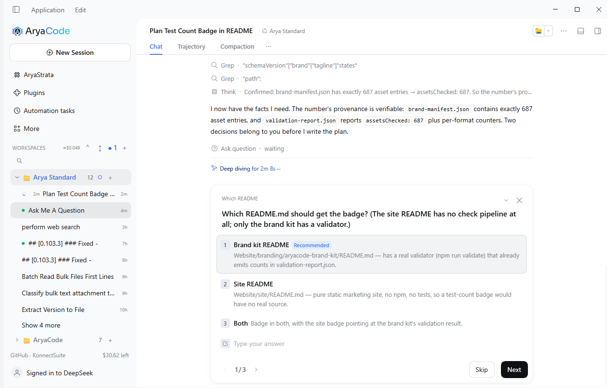
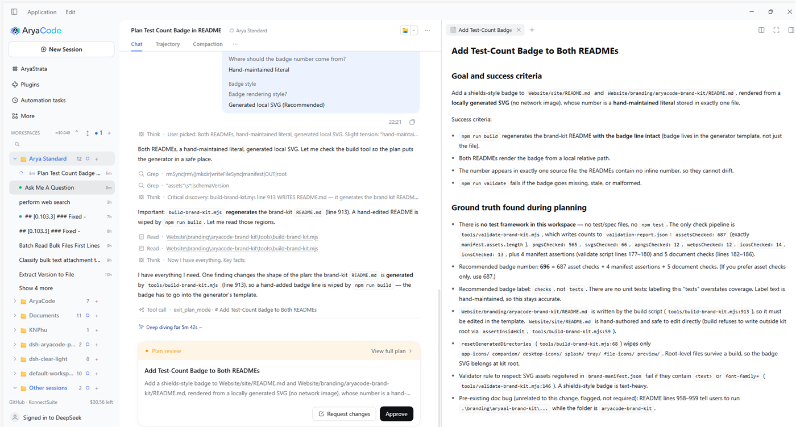

# Arya Standard

An agent preset that compacts the way [Codex](https://github.com/openai/codex)
does, shipped inside this bundle.

The preset is declared as data — `presets/arya-standard/definition.js` — and
registered through the Host's preset registry when the **Arya Standard preset**
switch is on. It then appears in the session picker next to the shipped presets,
and a session mounts it like any other: one composition, one row id.

## What it changes

| Part | Shipped `standard` | Arya Standard |
| --- | --- | --- |
| System prompt | "You are a coding agent…" plus the harness runtime context | Codex's own instructions, adapted once at registration to this harness's tool names |
| Compaction backend | `compaction-basic` | `compaction-basic` with the `summarize()` hook replaced |
| Checkpoint instruction | eight fixed Markdown sections | Codex's `CONTEXT CHECKPOINT COMPACTION` prompt |
| When it compacts | step pressure, provider overflow, model switch | the same three, plus a post-turn threshold and an absolute token limit |
| Checkpoint framing | `<compacted-summary>` tags | the same tags, with Codex's `SUMMARY_PREFIX` handoff sentence inside them |
| What survives | a priced recent tail of the whole surface | Codex's user-quote section over a verbatim tail, budgeted by `keepUserTokens` and capped at half of what is replaced |
| Subagents | `delegation` group | not mounted |
| Scheduled jobs | `tool-schedule` | not mounted |
| In-app plugin installs | `tool-plugin-manager`, `tool-plugin-market` | not mounted |

Everything else — the file, shell, search, skill, goal, plan, todo, web and
present tools, the `tool-result-pruner`, `/compact` — is the shipped toolset.

## The difference from `standard`, measured

Both presets mount the same `ReactLoopAgent`; a preset cannot replace the turn
machine. What differs is observable in a session log:

- **toolset** — an Arya Standard session declares exactly twelve fewer tools than a
  `standard` session: `interrupt_agent`, `list_agents`, `list_subagent_models`,
  `plugin_manager`, `schedule_create`, `schedule_delete`, `schedule_list`,
  `schedule_update`, `send_message`, `subagent`, `subagent_fork`, `workflow`;
- **prompt** — Codex's instructions, adapted once at registration;
- **compaction** — `compaction/summary` written by this bundle's `summarize()` hook
  carries Codex's handoff prefix and the verbatim user section, where `standard`
  writes the eight-section template wrapped in `<compacted-summary>`.

Everything else about a turn — when it starts, whether it continues, how tool calls
are dispatched — is the driver's, and identical in both presets.

## Why the engine is a subclass, not a rewrite

`@deepseek-ai/dsh-compaction` exports an abstract `CompactionEngine` whose base
class is empty: every behaviour — when to compact, which span is safe to split,
the durable `compaction/start` lock, stability revalidation, the shrink guard, the
single replacement message — lives in `compaction-basic`, and that package
documents `summarize(input, agent, signal)` as the one subclass hook.

So this bundle overrides exactly that hook (`presets/arya-standard/compaction.js`)
and nothing else. The consequences are deliberate:

- a failed summarization still leaves the blocking orphan `compaction/start` that
  the base engine's crash recovery expects, instead of a half-committed checkpoint;
- the summary is still refused when it would not shrink what it replaces — the
  verbatim user section is the part that gets dropped, never the summary;
- the auxiliary request is still replayed over the shadowed span, so it is a warm
  prefix rather than a cold one.

## Native capabilities

The persona is Codex's prompt, adapted, followed by one short section that names the
harness's own tools. Codex's text talks about its planner, its patch tool and its
CLI; without that section the model has `ask_user_question` and `exit_plan_mode` in
its catalog but no instruction to reach for them, which showed up as questions asked
in prose and plans that never reached the approval card.

The section (`presets/arya-standard/native.md`) tells the model, in one line each:

| Tool | What the persona says |
|---|---|
| `ask_user_question` | ask through the tool, never as prose at the end of a turn; batch independent questions, use `options` when the choices can be enumerated, and treat a skip as "continue" |
| `todo_write` | the plan list for multi-step work, one item `in_progress`, not while plan mode is active |
| `exit_plan_mode` | in plan mode, submit the plan through the tool rather than asking to proceed |
| `create_goal` / `get_goal` / `update_goal` | long-running objectives the user resumes later |
| `present` | declare finished files as deliverables |
| `skill` | load a matching skill before acting |
| `web_search` / `web_fetch` | current information, with cited URLs |

It is appended after the adapted Codex prompt, so Codex's working style is intact
and the harness mechanics override only where the two conflict. `test/arya-standard.spec.mjs`
fails if the section disappears, moves before the Codex text, or stops naming one of
those tools.

### Verified in the app

A plan-mode session on Arya Standard (0.108.2) at the local model: `/plan`
turned plan mode on, the model explored read-only, then asked through the tool:

Three questions, one page at a time, each with options and a recommended answer.
After the answers it submitted the plan through `exit_plan_mode`, which produced
the review card with **Request changes** / **Approve**:

The earlier session ("Ask Me A Question") had the same behaviour outside plan
mode: a question card appeared in the transcript and the turn resumed on the
answer.

## The trigger set

`compaction-basic` owns when to compact and how a summary is committed. Arya
Standard adds the two triggers Codex has and the base engine does not, both on the
idle transition after a turn, so they never race the turn that just ended:

- **post-turn threshold** (`model_post_turn_compact_threshold_percent`) — a share of
  the window, 90% by default. The engine's own pressure check runs before a step;
  this one runs after a turn, which is where Codex folds;
- **absolute token limit** (`model_auto_compact_token_limit`) — whichever of the two
  is lower wins, so a small window still compacts at a predictable token count.

Both are configured on the `arya-standard-policy` row, which publishes the
`aryaStandardPolicy` service. They cannot ride on the engine row: `compaction-basic`
validates a closed configuration key set and throws at mount on anything else.

Two more Codex behaviours live inside the summarizer:

- **drop-oldest-and-retry** — when the summarization request itself overflows
  (`Context window exceeded while compacting; removing oldest history item.` in
  Codex), the oldest whole turn leaves the replayed prefix and the request is
  retried, bounded by **Summarizer overflow retries**. The system prefix and the
  newest turn always survive;
- **an overridable checkpoint instruction** (`compact_prompt`) — the Settings field
  replaces the vendored `checkpoint-prompt.md`.

The two waterfalls `arya-standard/compaction/pre` and
`arya-standard/compaction/post` fire around the summarization request, mirroring
Codex's pre/post compact hooks. They observe a summary, not the durable commit: the
transaction stays the base engine's.

## What Codex does that this cannot

Codex's loop is a turn machine: it samples, runs the tool calls, and decides
mid-turn whether to roll into a new context window before the next sample. DSH's
`ReactLoopAgent` is not replaceable from a preset, so what belongs to the loop
itself stays out:

- **turn-scoped token accounting** (`model_auto_compact_token_limit_scope`) — DSH
  has one session-scoped meter, so a limit applies to the whole surface;
- **token-budget reminders and the auto-compact fallback prompt** — no equivalent
  fragment is injected near the limit;
- **speculative/async compaction** of a finished history;
- **approval policy** and the JSON-RPC turn/item model.

The retention difference is approximated, not reproduced. Codex rebuilds the
history as "every real user message (up to 20k tokens) plus one summary", dropping
every assistant and tool turn. DSH needs a verbatim tail: the loop resumes on the
surface, so replacing the newest step too makes the model lose the thread and stop
mid-task. The default is therefore Codex's user-quote section on top of DSH's own
retention (`retainRatio` 0.16), and the user-quote budget is half of what is
replaced rather than a tenth, so a conversation whose user messages are small still
carries their wording.

The `keepUserTokens` section is dropped whenever adding it would make the
checkpoint stop being smaller than the span it replaces — the base engine's shrink
guard, which a summary must never trip.

## Knobs

Settings → **Arya Standard**, or this row's Configure page. The group is
`aryaStandardOptions` on the `polish` row, and it is deliberately **not**
volatile: editing it re-runs `apply()` and rebuilds the definition, so sessions
created afterwards mount the new numbers while a running session keeps the ones it
started with.

| Knob | Default | What it does |
| --- | --- | --- |
| Compact automatically | on | Off leaves `/compact` as the only trigger. |
| Threshold | 0.9 | Fraction of the context window at which a compaction is worth starting. |
| Headroom | 16000 | Tokens held back below the model's window, so the summary request itself fits. |
| Verbatim tail | 0.16 | Fraction of the window kept unsummarized after a checkpoint. Codex keeps none; a live tool loop needs its last step. |
| Checkpoint budget | 20000 | Output cap for the summary request. |
| Keep the user's words | 20000 | Upper bound on the verbatim user section; also capped at half of what is replaced, and dropped when it would trip the shrink guard. |
| Post-turn threshold | 90 | Compact when a finished turn leaves the session this share of the window. 0 disables the trigger. |
| Absolute token limit | 0 (off) | Compact at this many tokens too, whichever trigger fires first. |
| Checkpoint instruction | empty | Replaces Codex's vendored checkpoint prompt. Empty keeps it. |
| Summary retries | 1 | Retries for a failed summarization. |
| Overflow retries | 1 | Retries after a provider-confirmed context-window error. |
| Summarizer overflow retries | 2 | Drop the oldest turn and retry when the summarization request itself overflows. |
| Summarizer provider / model | empty | Empty means "the model this session last routed to". |

## The Compaction tab

A **Compaction** view beside Chat and Trajectory, for every session — not only the
ones running the preset, because the numbers are worth seeing either way. Five
tabs:

- **Overview** — the live context pressure against the window and this preset's
  threshold, a stat row (checkpoints, tokens freed by compaction, requests, input
  tokens, cache hit rate), the trajectory, and **Compact now**, which runs
  `/compact` through the session's own command surface;
- **Trajectory** — one line per billed request (`inputTokens + cacheReadTokens`)
  against the window and threshold lines, with a mark at every checkpoint so a
  fold is visible next to the drop it caused, and a strip of how much of each
  request was already cached;
- **Checkpoints** — one card per committed checkpoint: messages replaced, tokens
  freed, sequence range, the model that wrote it, the summary text, manual or
  automatic;
- **Logs** — checkpoints and failed attempts, in time order, including the failure
  the base engine recorded on `compaction/end`;
- **Settings** — the same policy form as the Settings page and the row Configure
  page.

The data comes from the `aryaStandard` projection (`projection.js`, state version
3), which folds `request/context`, `assistant/message` usage, `compaction/summary`
and `compaction/end` out of the durable session log — the provider's own numbers,
not an estimate the browser makes up. No route of our own, no iframe: the tab
renders the same projections the rest of the chat does.

## Verifying it

1. `pnpm test` — the declaration, the summarizer hook and the browser surfaces.
2. `pnpm pack`, install into Dev AryaCode, reload.
3. Start a session, pick **Arya Standard**, run a few turns, then `/compact`.
4. The checkpoint's replacement message starts with Codex's handoff sentence; the
   **Compaction** tab shows one card, the trajectory gains a fold mark, and the
   gauge drops.

## Reading a session log

`compaction/summary` records everything the tab draws: `shadowedTokenCount`,
`shadowedRange`, `provider`, `model`, `maxTokens`, and the usage of the auxiliary
request. A checkpoint written by this preset is recognisable without any UI: its
replacement `user/message` begins with `SUMMARY_PREFIX`
(`Another language model started to solve this problem…`), while `compaction-basic`
writes `This is an automatically generated checkpoint…` and the
`<compacted-summary>` tags. `prefix` plus one text block means the verbatim user
section was dropped by the shrink guard.

## Attribution

`presets/arya-standard/prompt.md`, `checkpoint-prompt.md` and `summary-prefix.md`
are copied from [openai/codex](https://github.com/openai/codex) (`codex-rs/core/`
and `codex-rs/prompts/templates/compact/`), which is Apache-2.0; the licence text
is vendored beside them as `CODEX-LICENSE`. Only the base prompt is adapted, and
`adapt.js` lists every substitution so the differences are auditable.
