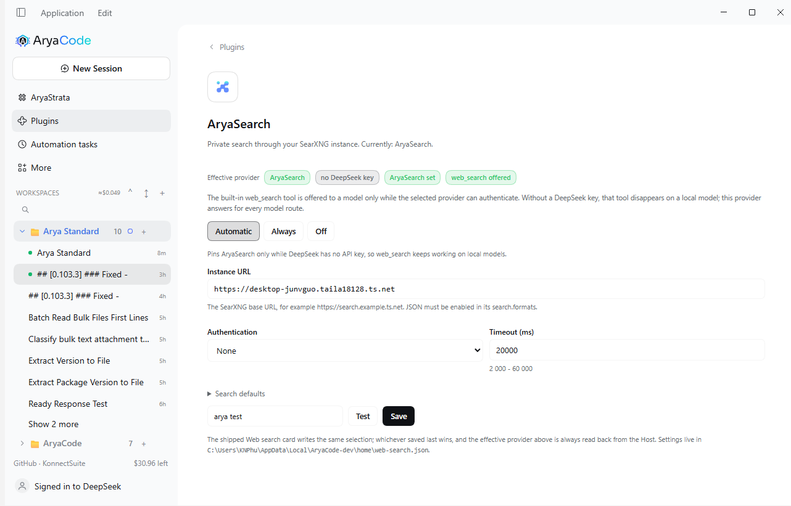
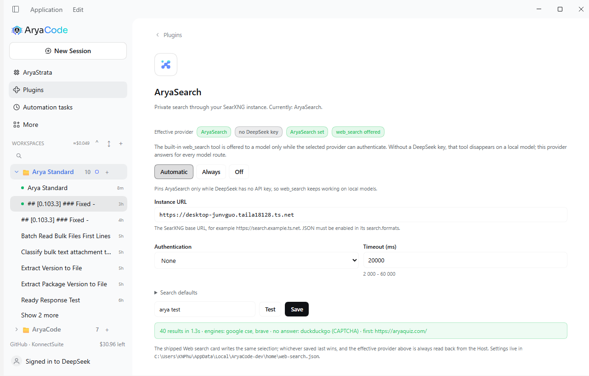

# AryaSearch

AryaSearch is your own SearXNG instance, registered on the harness's `ctx.web`
seam as a search provider. It exists for one reason: the built-in `web_search`
tool is only offered to a model while the **selected** search provider can
authenticate, and the shipped selection is DeepSeek. On a local model with no
`DEEPSEEK_API_KEY`, `web_search` is never declared. AryaSearch answers for every
model route, so the tool stays.

## What it looks like

The card with the instance configured, the pin applied and `web_search` reported
as offered:



**Test** runs a real query through the provider - result count, latency, the
engines that answered, the engines that did not, and the first URL - without
saving anything:



Both captures come from the development app with
`https://desktop-junvguo.taila18128.ts.net` configured and no DeepSeek API key.

## How it was verified

| Check | Result |
|---|---|
| Provider registered at boot | `aryasearch: provider registered as aryasearch (https://...)` in the host log |
| Real search through the seam | 38 results in 1.5 s, engines `google cse, brave`, `duckduckgo (CAPTCHA)` reported |
| Automatic pin | saving the URL moved `web.searchProvider` from `deepseek-official` to `aryasearch`, reason *no DeepSeek key* |
| Negative control | switching to **Off** restored `deepseek-official` and `readiness` flipped **true -> false** |
| Tool availability | `readiness` (read from `ctx.web.searchReady()`) is **true** only while the pin points at AryaSearch, with no DeepSeek key - which is exactly the gate that decides whether `web_search` is declared to the model |

The readiness number is the whole point of the feature: it is the same answer
`dsh-tool-web` asks on every model step before it declares the tool.

## Quick start

1. **Plugins -> AryaSearch** (next to the shipped **Web search** card).
2. Paste the instance URL, for example `https://desktop-junvguo.taila18128.ts.net`.
3. Press **Test**: it runs a real query and reports `12 results in 0.7s · engines: brave, google cse`.
4. Press **Save**. In the default **Automatic** mode this pins
   `web.searchProvider` to `aryasearch` while DeepSeek has no API key.
5. Start a chat turn on any model. `web_search` is now offered, and answers come
   from your instance.

## The three modes

| Mode | Behavior |
|---|---|
| **Automatic** (default) | Pins AryaSearch while DeepSeek has no key; restores the deployment's provider (`deepseek-official`) when a key appears. |
| **Always** | Keeps AryaSearch selected even when a DeepSeek key exists. |
| **Off** | Never changes the selection; clears the pin if it currently points at AryaSearch. |

The card always shows the **effective provider**, read back from the Host, so a
selection changed elsewhere is never misreported.

## Setup details

### The instance must allow JSON

SearXNG disables the JSON API by default. In its `settings.yml`:

```yaml
search:
  formats:
    - html
    - json
```

Without it the instance answers `403` with an HTML page; the card's Test says so,
naming `search.formats` rather than reporting a generic failure.

### Authentication

SearXNG has no accounts of its own; instances are usually protected by a reverse
proxy. The card supports:

- **None** - a Tailnet-only or LAN-only instance.
- **Bearer token** - either a credential reference (`ARYASEARCH_TOKEN`, stored in
  the harness credential store and resolved on every search) or a literal token
  (stored in `web-search.json`, masked in the UI).
- **Basic auth** - user and password.
- **Custom headers** - anything a proxy asks for, for example
  `CF-Access-Client-Id` / `CF-Access-Client-Secret`.

### Search defaults

Language, safe search, categories (`general,news`), time range and the request
timeout (2-20 s, default 20 s) are sent as SearXNG's own query parameters. The
number of results the model sees is the tool's own cap (`searchMaxResults`, 8 by
default); the seam truncates whatever the provider returns.

## What the model sees

The provider maps SearXNG's JSON to the same shape the DeepSeek provider returns:

| SearXNG | Seam |
|---|---|
| `results[].title` | source title (HTML entities decoded) |
| `results[].url` | source URL, deduplicated |
| `results[].content` | source snippet |
| `results[].publishedDate` | `publishedAt` |
| `answers[0].answer` | the result's `content` (the short answer) |

`unresponsive_engines` is reported by **Test**, not in the model's results: one
engine hitting a CAPTCHA is normal and not worth spending model context on.

## Failure modes

| Symptom | Cause | What you see |
|---|---|---|
| `AryaSearch refused the search (HTTP 403)` | JSON not enabled, or proxy auth missing | Test names `search.formats` and the auth fields |
| `... answered with text/html instead of JSON` | an HTML page was returned with status 200 | Test names the content type |
| `AryaSearch could not be reached at ...` | Tailnet down, DNS, wrong URL | Test shows the underlying error |
| `did not answer within 20s` | instance overloaded or unreachable mid-request | Test shows the timeout, not a hang |
| `no results` | the query genuinely matched nothing | an empty source list; the tool prints "No results found." |
| a `!bang` query | SearXNG redirects instead of searching | the destination becomes the single source |
| the card shows `web_search unavailable` | the pin is not on AryaSearch and the selected provider has no credential | the chip states it; save again in Automatic or Always mode |

## Why the pin lives in the `web` row

`web.searchProvider` is a **volatile** field on the `web` row. Writing it through
the settings service takes effect on the next tool step without a reload, and it
persists in the profile's settings document. That is the same field the shipped
**Web search** card writes with its own switch, so:

- whichever card saved last wins;
- the AryaSearch card never asserts ownership - it reads the effective value from
  the Host and shows it;
- turning the `aryaSearch` switch off resets the pin if it points at AryaSearch,
  so a disabled feature can never leave `web_search` pointing at an unregistered
  provider.

## Settings file

`$DSH_HOME/web-search.json` (Windows: `%LOCALAPPDATA%\AryaCode\home\web-search.json`),
written atomically, mode `0600` where the platform honours it:

```json
{
  "version": 1,
  "settings": {
    "mode": "auto",
    "baseURL": "https://desktop-junvguo.taila18128.ts.net",
    "auth": "none",
    "tokenRef": "",
    "token": "",
    "basicUser": "",
    "basicPass": "",
    "headers": {},
    "language": "",
    "safesearch": "",
    "categories": "",
    "timeRange": "",
    "timeoutMs": 20000
  }
}
```

A corrupt file is renamed `web-search.json.corrupt-<timestamp>` and the card
starts from defaults instead of failing.

## The code

| Path | What it is |
|---|---|
| `entries/web-search.js` | the feature: provider registration, pin policy, one POST route (`api/polish.websearch`) |
| `web/provider.js` | URL building, auth, SearXNG mapping, timeout and error taxonomy |
| `web/settings.js` | defaults, validation, masking, the JSON file |
| `client/aryasearch.js` | the Plugins card |

## What it does not do

- **No fetch provider.** `web_fetch` stays on the anonymous HTTP provider;
  SearXNG cannot fetch arbitrary pages, and a proxy reader endpoint would be a
  second failure mode for no gain.
- **No per-agent selection.** The seam has one selection per profile.
- **No fallback chain.** If AryaSearch is unreachable the search fails with the
  error above; it does not silently switch to DeepSeek mid-search. Mode
  **Automatic** is the fallback story: it restores DeepSeek as soon as a key
  exists.
