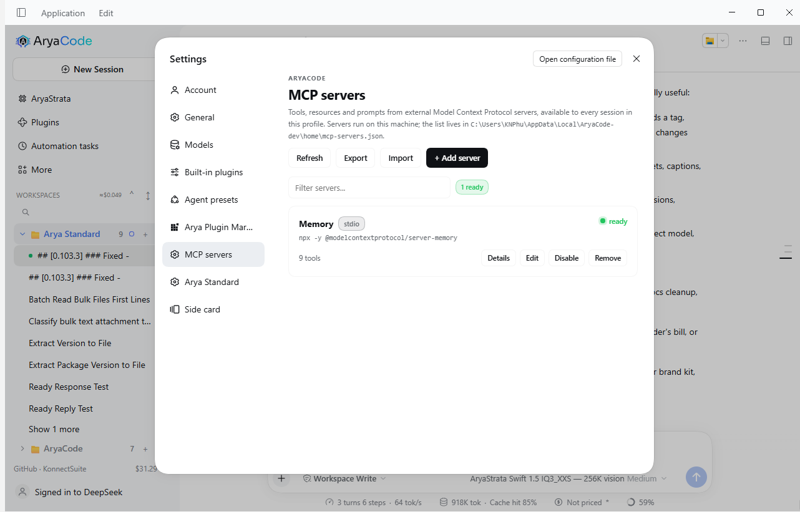
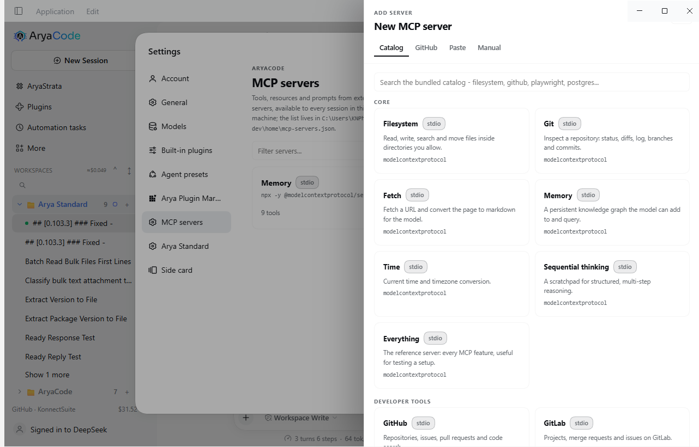
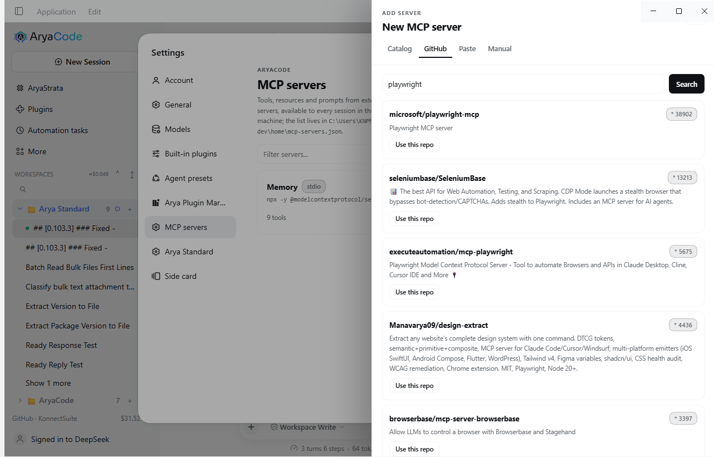
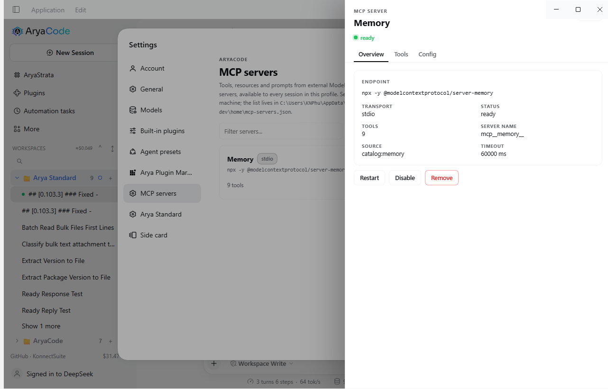
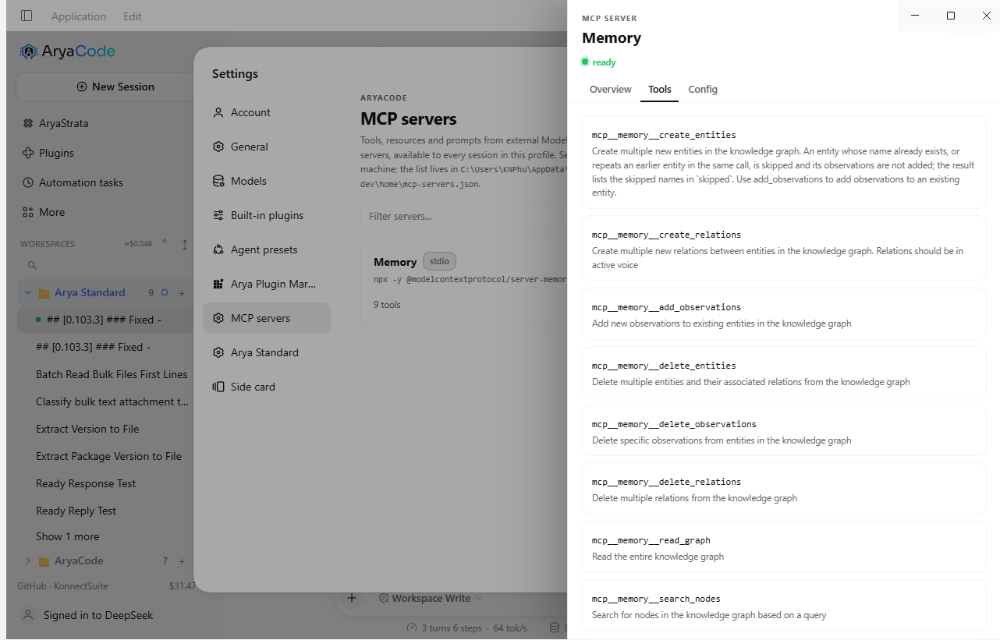
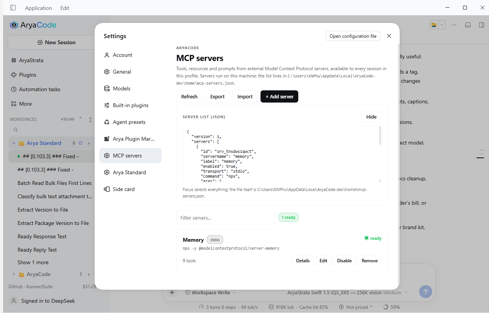

# MCP servers

**MCP** in the sidebar manages the Model Context Protocol servers AryaCode
connects to. It is the `mcpManager` feature of this bundle, on by default, and it
is the only place a server needs to be added: no YAML, no restart. The page also
lists servers another patch layer mounts, with the same switch.



One stdio server installed through the catalog, connected, with the nine tools it
contributes. The card says what runs, where it runs, and whether it is healthy;
the buttons under it act on the live fiber.

## Quick start

1. **Open the page.** The **MCP** row in the sidebar.
2. **Pick a server.** Press **Add server** and choose a tab: the bundled
   catalog, a GitHub search, a paste box, or the manual form.
3. **Test, then Add.** The form's **Test** button mounts the draft in a throwaway
   fiber and reports how many tools arrived. **Add server** saves the entry and
   mounts it for real.

That is the whole flow. The next chat turn already sees the new tools as
`mcp__<name>__<tool>`.

## How-tos

### Install a server from the catalog

The catalog is a curated list of 40 servers, grouped by category (`Core`,
`Developer tools`, `Data`, `Search`, `Productivity`, `Cloud`), with the command,
transport and required environment variables already filled in.



1. **+ Add server** -> **Catalog**.
2. Type in the search box to filter, or scroll a category.
3. Click a card. The sheet switches to **Manual** with the name, command,
   arguments and any env keys prefilled. Cards that need a secret say so:
   `by modelcontextprotocol - needs GITHUB_PERSONAL_ACCESS_TOKEN`.
4. Fill the secret if the entry asks for one, tick the trust box, press **Test**.
5. Press **Add server**.

The catalog installs nothing by itself: the entry is a config. `npx`/`uvx`
fetches the package on first connection, the same way a terminal would.

### Find a server on GitHub



1. **+ Add server** -> **GitHub**.
2. Type something like `playwright mcp` and press **Search** (or Enter).
3. Results are repositories sorted by stars. **Use this repo** prefills a stdio
   draft (`npx -y <repo-name>`) that you can correct against the README before
   testing.

The search runs on the Host. It uses `GITHUB_TOKEN` when the environment has one,
then the GitHub CLI's session (`gh auth token`), and unauthenticated otherwise.
Unauthenticated searches are rate limited; the tab says so instead of failing.

### Paste an install command, a URL or JSON

1. **+ Add server** -> **Paste**.
2. Paste one of:
   - a command line: `npx -y @modelcontextprotocol/server-memory`, `uvx
     mcp-server-git --repository .`, `docker run ...`;
   - a remote endpoint: `https://mcp.example.com/mcp`;
   - a single server object, an array of servers, or a full exported store.
3. **Parse**. A command line becomes a stdio draft, a URL becomes a streamable
   HTTP draft, and a list is imported and saved in one step (the result says how
   many landed and how many failed).

### Add a server by hand

**+ Add server** -> **Manual**. Two transports:

- **stdio (a local command)** - `command`, `arguments`, `environment`,
  `working directory`. This runs a process on your machine.
- **streamable HTTP (a service)** - `url` and optional `headers` (for example
  `Authorization: Bearer ...`).

Every entry also has `name` (the `mcp__name__` prefix, 1-32 letters, digits, `_`
or `-`), `label` (what the card shows), and under **Advanced** a tool timeout and
a reconnect switch.

### Add a token or environment variable

In the manual form's **Environment** box, `+ Add variable`, then a key and a
value - for example `GITHUB_PERSONAL_ACCESS_TOKEN` and a token. Values whose key
looks like a token, key, secret, password or authorization header are stored as
secrets: the page masks them as `********` after saving, and shows a `password`
field while typing. **Headers** works the same way for HTTP servers.

### Change a server

**Edit** on a card (or in the detail drawer). The form opens with the saved
values; secrets are blank rather than shown, so leaving them empty keeps the
stored value. Saving disposes the old fiber and mounts the new one, so the tools
reflect the change immediately.



**Details** opens a read-only drawer with three tabs:

- **Overview** - the endpoint, transport, status, tool count, the `mcp__name__`
  prefix, the entry's source (`catalog:github`, `manual`, ...) and the tool
  timeout, with **Restart**, **Disable/Enable** and **Remove**.
- **Tools** - every tool the server contributes, with its description, read from
  the live registry.
- **Config** - the config the page would send, as JSON, with **Copy config**.

### Disable, enable, restart

**Disable** disposes the fiber: the server's tools disappear from every session
and the child process exits. The entry stays in the list, greyed out. **Enable**
mounts it again. **Restart** is Disable followed by Enable without changing the
entry, for a server that wedged.



### Remove a server

**Remove** asks once, then deletes the entry and disposes the fiber. Nothing is
uninstalled: the package or container is still on the machine, and the entry can
be re-added (or restored from an export).

### Export the list, or import it elsewhere

**Export** renders the whole list as a selectable JSON panel: focus the box and
everything is selected, then copy. The file itself is named in the panel footer.



**Import** opens the **Paste** tab. Paste an exported store or any JSON array of
servers and it saves them in one step, reporting `Imported 2 servers.` or which
entries failed and why. Importing on a fresh profile is the fast way to move a
carefully tuned list between machines.

> Exports include secrets, because the file does. Treat an exported store like a
> password file.

### Test a draft without saving it

**Test** in the add or edit sheet mounts the draft, waits up to 20 seconds for
the first tool sync, reports `Connected in 7.3s - 9 tools discovered.` and then
disposes it. Nothing is written. If the draft replaces a saved server, the saved
one is remounted afterwards.

### Use the tools in a chat

Nothing to do: the page and the model read the same registry. The tool names are
`mcp__<serverName>__<toolName>`, so a server named `memory` exposes
`mcp__memory__create_entities`, `mcp__memory__search_nodes`, and so on. The
**Tools** tab is that registry, filtered to one server - if it lists nine tools,
the next turn can call nine tools.

Resources work through the three shared tools the harness always ships
(`list_mcp_resources`, `list_mcp_resource_templates`, `read_mcp_resource`).

### Find the list file

The path is printed in the page's header. Usually:

- Windows: `%LOCALAPPDATA%\AryaCode\home\mcp-servers.json`
  (development build: `%LOCALAPPDATA%\AryaCode-dev\home\mcp-servers.json`)
- macOS/Linux: `$DSH_HOME/mcp-servers.json`, else `~/.aryacode/mcp-servers.json`

The page writes it atomically and reads it at startup, so a hand edit is safe
while the app is closed: enabled servers are mounted on the next boot before any
page is opened.

## What the page does

- **Lists every server** in the profile with live health (`ready`, `connecting`,
  `error`, `disabled`) and the tools it contributes.
- **Adds servers four ways**: the bundled catalog, a GitHub search, a paste box
  that understands a command line, a URL or JSON, and a manual form.
- **Tests before saving**, in a throwaway fiber with a 20 s cap.
- **Enables, disables, restarts and removes** without restarting AryaCode.
- **Exports and imports** the list as JSON.
- **Shows servers another plugin mounted** (for example the Windows computer-use
  server, whose tools are `mcp__wincu__*`) as read-only cards, so the page never
  hides a namespace the model can see.

## The list file

```json
{
  "version": 1,
  "servers": [
    {
      "id": "srv_lk3f9a",
      "serverName": "github",
      "label": "GitHub",
      "enabled": true,
      "transport": "stdio",
      "command": "npx",
      "args": ["-y", "@modelcontextprotocol/server-github"],
      "env": { "GITHUB_PERSONAL_ACCESS_TOKEN": "..." },
      "cwd": "",
      "url": "",
      "headers": {},
      "toolCallTimeoutMs": 60000,
      "failOnStartupError": true,
      "reconnect": { "enabled": true },
      "category": "dev",
      "source": "catalog:github",
      "createdAt": 1793474668647,
      "updatedAt": 1793474668647
    }
  ]
}
```

- **Secrets are stored in plain text** in that file, mode `0600` where the
  platform honours it. The page masks anything whose key looks like a token, key,
  secret, password or authorization header before it reaches the browser.
- A corrupt file is renamed `mcp-servers.json.corrupt-<timestamp>` and the page
  starts empty instead of failing.
- Deleting a server removes its entry; it does not uninstall anything.

## How a server is mounted

Each enabled server mounts `@deepseek-ai/dsh-mcp-client` - the harness's own MCP
bridge - as a child plugin of this feature, with the bridge's documented config:

```js
ctx.plugin(mcpClient, {
  transport: 'stdio',          // or 'streamable-http'
  serverName: 'github',        // tools appear as mcp__github__<tool>
  command: 'npx',
  args: ['-y', '@modelcontextprotocol/server-github'],
  env: { GITHUB_PERSONAL_ACCESS_TOKEN: '...' },
  failOnStartupError: true,
  reconnect: { enabled: true },
})
```

The bridge registers the server's tools on `ctx.tools` and its resources on
`ctx.mcpResources`. Removing or disabling a server disposes the fiber; the tools
disappear with it. That is why add, remove and disable take effect without a
restart.

## Why a JSON file and not profile rows

A `cordis.patch.yml` row is the canonical shape for a plugin, and this bundle
would prefer it. Two facts stop it:

1. `configForms` writes only **volatile** fields, and the bridge's `Config` has
   none - a row-based editor in the app cannot save one.
2. A plugin cannot create a loader row at all; `configEditor` edits existing
   entries only.

So the list lives at `$DSH_HOME/mcp-servers.json`, written atomically, and the
bridge is mounted at runtime. The trade-off is honest: these servers do not
appear in the Plugins page, and `dsh --dump-config` does not show them. If the
harness ever exposes row creation to plugins, moving the store onto rows is a
contained change - `mcp/manager.js` is the only module that mounts anything.

## Failure modes, and what the page says

| Symptom | Cause | What you see |
|---|---|---|
| `command not found` | the command in the entry does not exist | card `error` with the OS message; the model simply has no tools from that server |
| `Test failed: No tool sync within 20s` | a slow or hung server | the draft is disposed; nothing is saved |
| `GitHub rate limit reached` | unauthenticated GitHub search | the GitHub tab says so; the catalog and manual form keep working |
| `The MCP bridge is not available in this build` | a host without `@deepseek-ai/dsh-mcp-client` | a banner on the page; everything else still renders |
| `"x" is already used by "y"` | duplicate `serverName` | the form marks the field before saving |
| the card says `connecting` for a long time | the server accepts the process but never completes `initialize` | it stays that way until the tool timeout; **Restart** or check the command by hand |

## Reference

### Fields

| Field | Meaning |
|---|---|
| `serverName` | bridge namespace; tools become `mcp__<serverName>__<tool>`; 1-32 of `A-Z a-z 0-9 _ -`; unique in the profile |
| `label` | the card's title; defaults to `serverName` |
| `transport` | `stdio` or `streamable-http` |
| `command`, `args`, `env`, `cwd` | stdio only; the process the bridge spawns |
| `url`, `headers` | streamable HTTP only |
| `enabled` | whether the fiber mounts at startup |
| `toolCallTimeoutMs` | per-call timeout, 1000-600000, default 60000 |
| `failOnStartupError` | true for managed servers, so a dead command shows as `error` instead of silence |
| `reconnect.enabled` | the bridge's own reconnect policy |
| `source` | `catalog:<id>`, `manual`, `paste`, or `import` - where the entry came from |

### Catalog categories

`core` (filesystem, git, fetch, memory, time, sequential thinking, everything),
`dev` (github, gitlab, sentry, playwright, puppeteer, chrome devtools, docker,
kubernetes, context7, e2b), `data` (postgres, sqlite, mysql, redis, mongodb,
supabase, neon), `search` (brave, exa, tavily, google maps), `productivity`
(notion, slack, linear, atlassian, figma, obsidian, google drive), `cloud` (aws,
azure, cloudflare, vercel, grafana, stripe).

### The code

| Path | What it is |
|---|---|
| `entries/mcp.js` | the feature plugin: manager + one route |
| `mcp/validate.js` | the field rules and the bridge config mapping |
| `mcp/store.js` | the JSON file, corrupt-file recovery, secret masking |
| `mcp/manager.js` | one bridge fiber per enabled server, status, tools, external servers |
| `mcp/routes.js` | the single POST route `api/polish.mcp` |
| `mcp/catalog.json` | the bundled catalog |
| `client/mcp.js` | the page |

## What it does not do

- **No resource browser.** `mcpResources` exposes `register()` only, so the page
  shows the tools a server contributes and the model keeps using the three shared
  resource tools for documents.
- **No MCP prompt templates** - the bridge itself does not support them.
- **No MCP server mode.** AryaCode consumes MCP; it publishes ACP and the SDK
  JSON-RPC surface instead.
